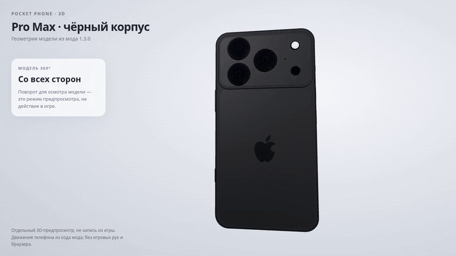

# Телефон Pro Max — 3D-просмотр и движения

Распакуйте ZIP и откройте `PocketPhone_3D_Preview.html` обычным браузером.
HTML содержит модель и все скрипты; для просмотра интернет не нужен.

- **Осмотр**: мышь поворачивает корпус, колёсико меняет масштаб.
- **Спереди / Сзади / Сброс**: быстрые ракурсы модели.
- **Движения**: включите воспроизведение; кнопка паузы останавливает ролик.
- Шкала времени позволяет рассмотреть любой момент.

12-секундная последовательность: поворот для осмотра, доставание, обычный хват,
приближение, касание, отдаление, движение при ходьбе и убирание телефона.
Геометрия взята из PhoneDesign мода PocketPhone 1.3.0. Движения корпуса
используют формулы Plugin.LateUpdate и PhoneLayout: доставание / убирание
0,36 с, приближение / отдаление 0,30 с, отклик на касание 0,28 с.
Поворот на 360° добавлен только для осмотра в этом предпросмотре.
Пример рассчитан для FOV 60°, стандартного размера телефона и ходьбы 2 м/с.

Это отдельный 3D-рендер корпуса и его движений. Игровые руки, игровое освещение
и страницы браузера в нём не показаны. Передняя поверхность — стекло модели;
интерфейс браузера в игре накладывается отдельно. Эти файлы открываются
самостоятельно и не меняют установленный мод.

`PocketPhone_Model_1.3.0.glb` — статическая модель для Blender и других
просмотрщиков glTF. Воспроизведение движений доступно в HTML и готовом видео.

Проверены поворот мышью, масштаб, кнопки ракурсов, запуск / пауза,
перемотка и отсутствие прокрутки страницы в настоящем Chromium.
Видео: 1280×720, 30 FPS, 360 кадров, 12 секунд. GIF: 768×432, 12 FPS.
GLB: 62 детали, 46 211 треугольников, 11 материалов.

Просмотр использует Three.js 0.160.0, лицензия MIT приложена и встроена в HTML.
Исходный пакет проверен по SHA512 из npm; данные сохранены в THREE_PROVENANCE.json.

[Открыть видео MP4](downloads/PocketPhone_Animations_1.3.0.mp4) ·
[Скачать интерактивный просмотр](downloads/PocketPhone_3D_Preview_1.3.0.zip) ·
[Скачать статическую модель GLB](downloads/PocketPhone_Model_1.3.0.glb)

